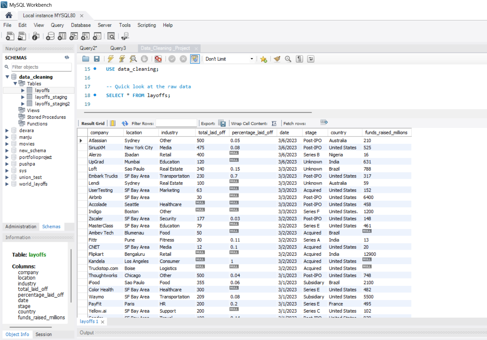
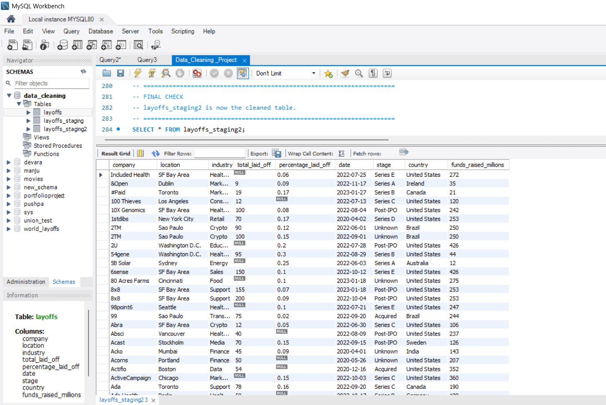

# 🧹 World Layoffs Data Cleaning: MySQL

## 📌 Project Overview
An end-to-end **Data Cleaning** project built in **MySQL**, turning a raw, messy global
layoffs table into a clean, analysis-ready dataset. The raw table is never modified;
all work is done in staging tables.

---

## 📸 Before vs After
**Before (raw data)**


**After (cleaned data)**


---

## 📁 Dataset Details
| Field            | Details                                  |
|------------------|------------------------------------------|
| Source Table     | `layoffs` (global layoffs data)          |
| Database         | MySQL 8+                                 |
| Raw Rows         | 2361                                     |
| Cleaned Rows     | 1995                                     |
| Staging Tables   | `layoffs_staging`, `layoffs_staging2`    |

---

## 📊 Columns
| Column                 | Description                               |
|------------------------|-------------------------------------------|
| company                | Company name                              |
| location               | City / location of the company            |
| industry               | Industry of the company                   |
| total_laid_off         | Number of employees laid off              |
| percentage_laid_off    | Percentage of workforce laid off          |
| date                   | Date of layoff (converted from text)      |
| stage                  | Funding stage of the company              |
| country                | Country of the company                    |
| funds_raised_millions  | Funds raised (in millions USD)            |

---

## 🔧 Steps Performed

### 0. Staging Table
- Created `layoffs_staging` using `CREATE TABLE ... LIKE` and copied all data
- Verified row counts match before cleaning

### 1. Remove Duplicates
- Used `ROW_NUMBER() OVER (PARTITION BY ...)` inside a CTE across all columns
- Created `layoffs_staging2` with a `row_num` column (MySQL cannot delete from a CTE)
- Deleted rows where `row_num > 1`

### 2. Standardize Data
- `TRIM()` to remove extra spaces in company names
- Merged industry variants (Crypto / CryptoCurrency) into one label
- Fixed trailing dot in country (`United States.` → `United States`)
- Converted `date` from text to `DATE` using `STR_TO_DATE()` and `ALTER TABLE`

### 3. Handle NULL & Blank Values
- Converted blank industry values to `NULL`
- Filled missing industry using a **self-join** on the same company
- Manually filled the remaining cases (Airbnb, Juul)

### 4. Remove Unnecessary Data
- Deleted rows where both `total_laid_off` and `percentage_laid_off` are NULL
- Dropped the helper column `row_num`

---

## 💡 Key Learnings
- 🔁 Duplicates must be found by comparing **all columns**, since the table has no unique ID
- 🧪 Always run a preview `SELECT` before every `UPDATE` / `DELETE`
- 🛡️ Staging tables protect the raw data if something goes wrong
- 🔗 A self-join can fill missing values using other rows of the same entity
- 📅 Convert text dates to `DATE` only **after** the values are in the right format

---

## 📂 File Structure

```
World-Layoffs-SQL-Data-Cleaning/
│
├── Data_Cleaning_Project.sql   # Full cleaning script
├── layoffs.csv                 # Raw dataset
├── before.png                  # Raw data screenshot
├── after.png                   # Cleaned data screenshot
└── README.md                   # Project documentation
```

---

## 🛠️ Tools & Skills Used
- **MySQL 8** and **MySQL Workbench**: primary tools
- **CTEs** and **Window Functions**: duplicate detection
- **Self-Joins**: filling missing values
- **String & Date Functions**: `TRIM`, `STR_TO_DATE`
- **DDL & DML**: `CREATE`, `ALTER`, `UPDATE`, `DELETE`
- **Data Quality Checks**: row counts and validation queries

---

## 🚀 How to Use
1. Create a database: `CREATE DATABASE data_cleaning;`
2. Import `layoffs.csv` into a table named `layoffs` (Workbench → Table Data Import Wizard)
3. Open `Data_Cleaning_Project.sql` in MySQL Workbench
4. Run it section by section and check each preview query first
5. The final cleaned table is `layoffs_staging2`

---

## 👤 Author
**Chanchalla Manju**
📧 manjuchanchalla@gmail.com
🔗 www.linkedin.com/in/chanchalla-manju-0688062a3

---

## 🏷️ Tags
`SQL` `MySQL` `Data Cleaning` `Window Functions` `CTE`
`Data Analytics` `Portfolio Project` `Layoffs`
